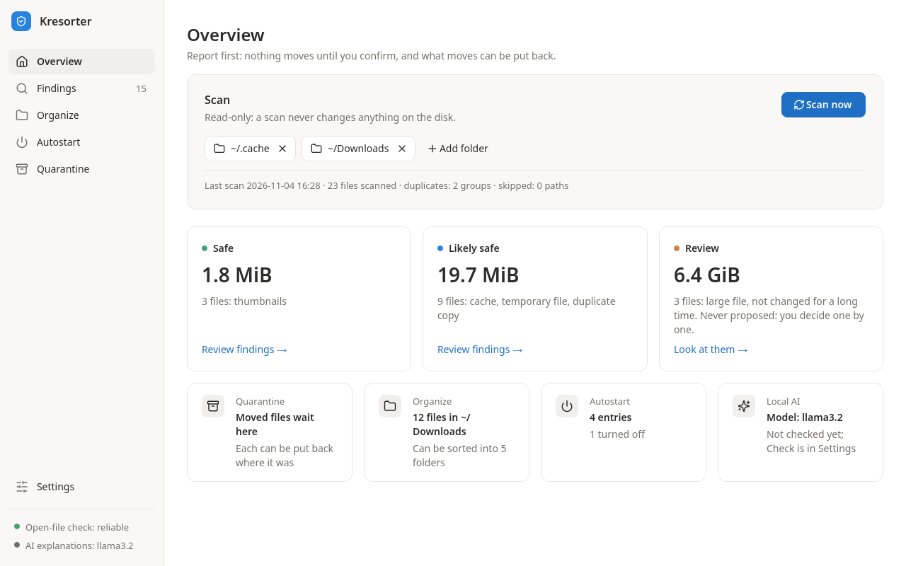
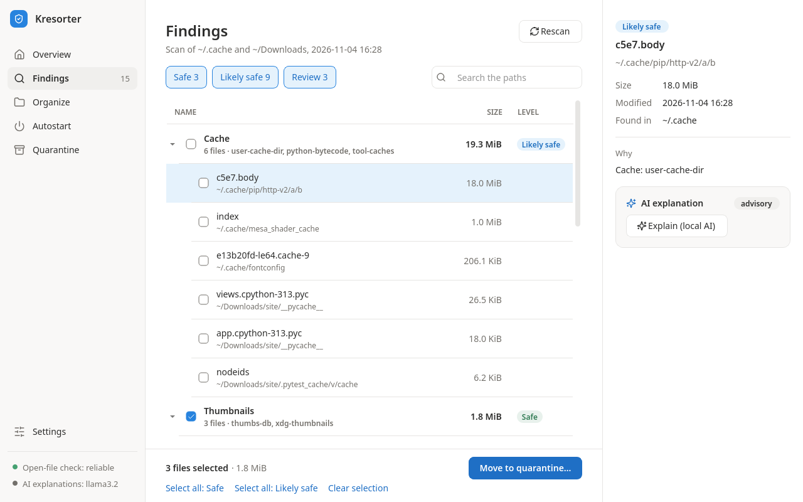
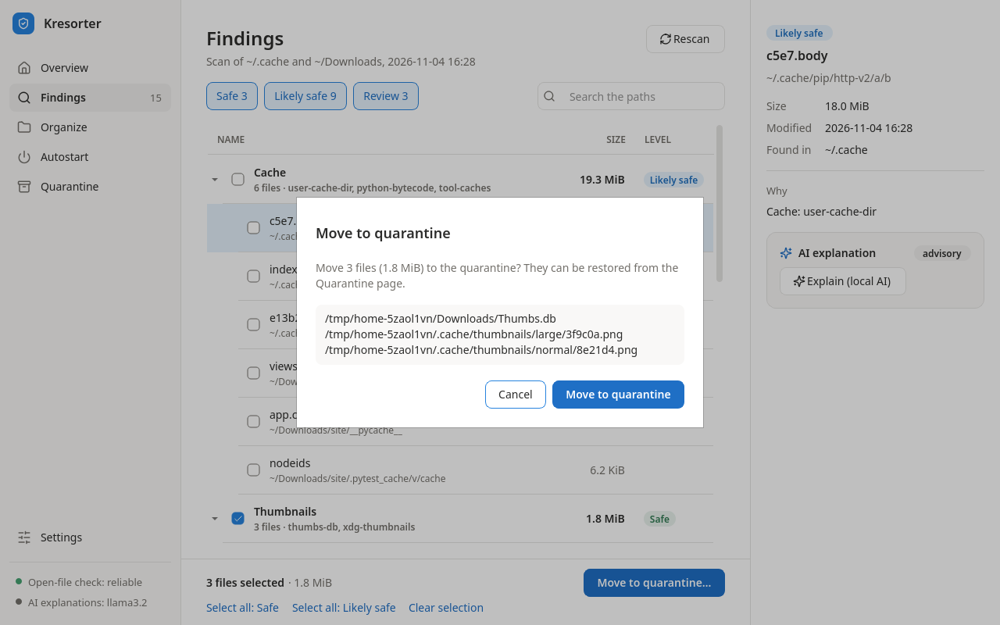
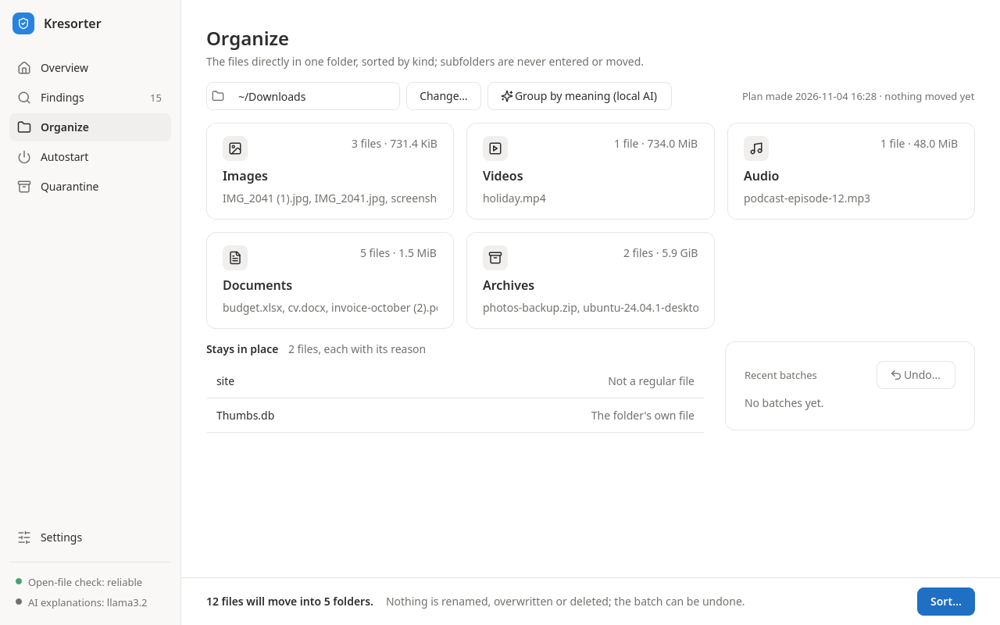
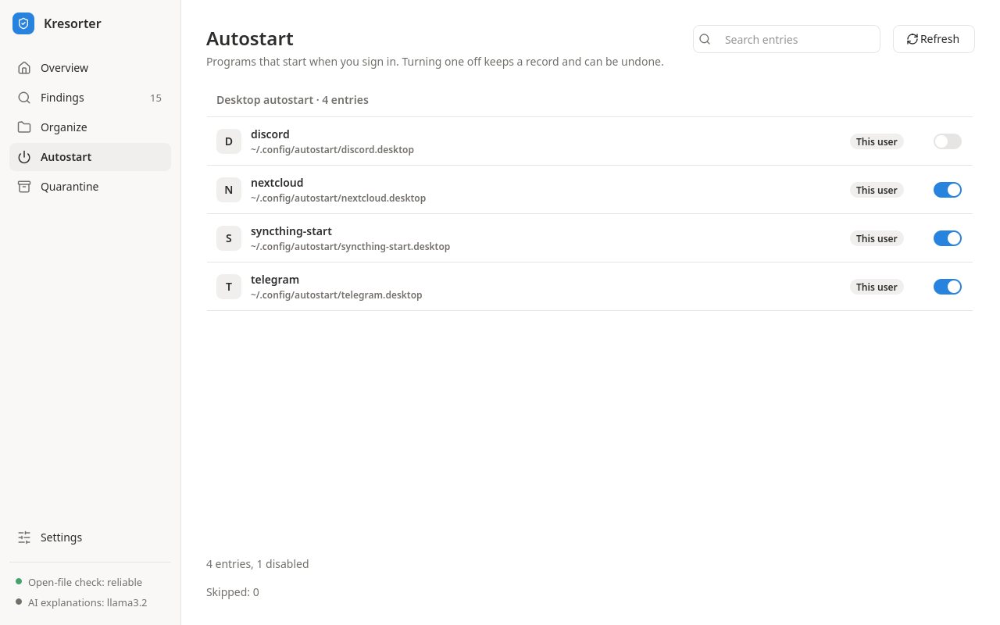
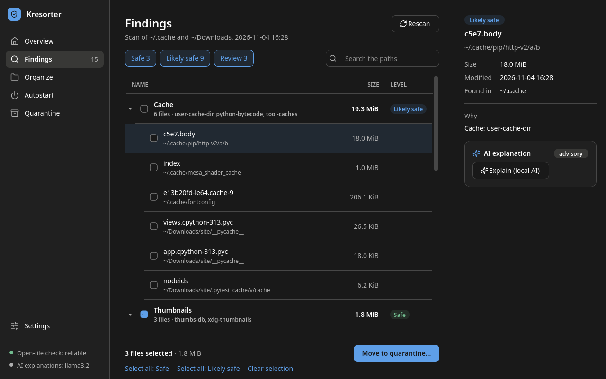

# Kresorter

Cross-platform desktop app for **safe** cleanup and triage of files on your PC.
Open source, local-only, no telemetry.

> Status: alpha, on Windows and Linux: the window and the console commands. See
> [what each system can do](#what-each-system-can-do) and the [roadmap](docs/roadmap.md).



## Safety principles

- **Report first.** Nothing is deleted automatically: full report → quarantine → delete only after confirmation.
- **Everything is reversible.** Every action is journaled before it happens and can be rolled back.
- **No direct deletion.** All removal goes through the quarantine API; `os.remove`, `shutil.rmtree`
  and friends are banned in code *and* tests (enforced by ruff and a test).
- **Safe zones by default.** Program Files, user profiles and open files are blacklisted.
- **Local only.** No telemetry; the optional AI explanations come from Ollama on your own
  machine, over loopback only, and are only ever shown.

## Install

### Windows

From the [releases](https://github.com/KKrecker/kresorter/releases), download one of:

- `Kresorter-<version>-setup.exe`, the installer: for you only, with no administrator rights,
  into `%LOCALAPPDATA%\Programs\Kresorter`, with a Start menu shortcut (a desktop one if you
  ask) and an entry in Settings → Apps;
- `Kresorter-<version>-portable.zip`, the same program as a folder: unzip it anywhere and run
  `Kresorter.exe` in it.

Both are the window, and both keep their data in `%LOCALAPPDATA%\kresorter`. The console
commands come with pipx, as on Linux: `pipx install kresorter`, with Python 3.11 or newer.

The installer and `Kresorter.exe` are not signed yet, so SmartScreen stops them the first time
("Windows protected your PC"): choose **More info**, then **Run anyway**. Before that, check
what you downloaded against `SHA256SUMS.txt` of the same release, a line per file: the hash
PowerShell prints, in capitals, is the one on your file's line.

```powershell
Get-FileHash .\Kresorter-<version>-setup.exe -Algorithm SHA256
```

### Linux

With [pipx](https://pipx.pypa.io) and Python 3.11 or newer:

```bash
pipx install "kresorter[ui]"   # the window, kresorter-ui, and the commands
pipx install kresorter         # or the commands only
```

The window needs a few of Qt's system libraries; [Desktop app](#desktop-app-optional) names
them.

### What each system can do

| | Windows | Linux | macOS |
| --- | --- | --- | --- |
| Scan and analyze | yes | yes | yes |
| Quarantine | yes | yes | no: refused |
| Organize | yes | yes | no: refused |
| Autostart: list | yes | yes | yes |
| Autostart: disable, enable | `HKCU` Run values | XDG entries | no: listed only |
| Recover | yes | yes | yes |
| AI explanations | yes | yes | yes |
| The window | installer, zip or pipx | with pipx | with pipx, untested |

macOS has no build and no CI: its column is what the code does there, untried on a Mac. The
quarantine and organize refuse there (exit code 3) because macOS has no open-file check yet.

An installation is checked with the self-test CI runs on every build:
`Kresorter.exe --self-test report.txt` in the program's folder on Windows, or
`kresorter-ui --self-test report.txt` with pipx. It opens the window, shows each page and
closes it, changing nothing, then writes a line per page to `report.txt` (`overview: shown`
and so on) and exits with 0; when something fails, the report has the error and the exit code
is 1. How to remove Kresorter is under [Uninstalling](#uninstalling).

## Usage (console)

### Reports: `scan`, `analyze`

```bash
kresorter scan                 # default safe zones: ~/.cache and ~/Downloads
kresorter scan ~/Projects /tmp # explicit roots (Temp only when chosen explicitly)
kresorter scan --json --no-hash ~/Downloads
kresorter analyze              # a safety level and the reasons for each finding
kresorter analyze --json --large 1024 --older-than 365 ~/Downloads
```

Neither changes the disk, not even kresorter's data directory. `scan` lists junk candidates,
duplicate groups and everything it skipped, with the reason. `analyze` rates each finding
`safe`, `likely_safe` or `review` and says why; which copy of a duplicate group stays is
decided for you and that copy is never proposed. Large (`--large`, MiB) and old (`--older-than`,
days unmodified) files are listed for review only.

A cache is `likely_safe`: proposed, but never chosen for you, since the program that made it
has to make it again; thumbnails and the systems' folder metadata stay `safe`. But a browser's
cache is `review` (Chrome, Chromium, Firefox, Edge, Brave, Opera, Vivaldi, Yandex), never
proposed: the browsers say it holds no sign-ins, which they keep in their cookies, outside it,
yet making it again costs the time and the traffic of every page, so the choice is yours
([decision 0018](docs/decisions/0018-owners-requests.md)).

### Quarantine

```bash
kresorter quarantine add ~/Downloads/old.iso   # move aside (reversible)
kresorter quarantine add --from-analysis --level safe        # show what would move
kresorter quarantine add --from-analysis --level safe --yes  # move it
kresorter quarantine list                      # ids, original paths, sizes
kresorter quarantine restore 3                 # put back; never overwrites
kresorter quarantine purge 3                   # show what would be deleted; deletes nothing
kresorter quarantine purge --yes 3             # permanently delete the vault copy
```

Every file is checked again right before it moves. `--from-analysis` takes `safe` findings, or
`safe` and `likely_safe` with `--level likely_safe`; `review` is never moved in bulk. The
quarantine needs a reliable open-file check: Linux and Windows have one; on macOS these commands
refuse (exit code 3) until its backend exists. On Windows the check is an exclusive open, closed
at once, so it sees every program that reads, writes or deletes the file, but not one that
holds it open for its attributes only, nor a file mapped into memory after its handle was
closed.

### Autostart

```bash
kresorter autostart list                      # every entry with its id; report only
kresorter autostart list --json --include-machine  # Windows: also HKLM, services, tasks
kresorter autostart disable 3f2a9c0d1b7e      # show what would be written
kresorter autostart disable 3f2a9c0d1b7e --yes
kresorter autostart enable 81d4e0a6c2f9 --yes # the id from a new 'list'
```

`list` shows each entry's id; any unique beginning of it is enough, and an entry that changed
since it was listed has another one. Two sources can be changed: XDG autostart entries on Linux
and `HKCU` Run values on Windows; every other source is listed, never written. Nothing is ever
deleted: your own entry is replaced by a copy with `Hidden=true` and the original is kept; a
system entry is shadowed by a stub in your autostart directory, `/etc` is never written; a Run
value gets the `StartupApproved` flag the Task Manager writes, the value itself is never
touched. `enable` puts back only what kresorter changed.

### Organize

```bash
kresorter organize move ~/Downloads        # show the plan; changes nothing
kresorter organize move ~/Downloads --yes  # sort it: ~/Downloads/<Category>/<name>
kresorter organize list                    # batches, newest first
kresorter organize undo 4                  # show what would move back
kresorter organize undo 4 --yes            # move it back
```

Only the regular files directly in the folder move, each to `<folder>/<Category>/<its name>`
(`Images`, `Videos`, `Audio`, `Documents`, `Archives`, `Installers`); subdirectories are never
entered or moved. Nothing is renamed, overwritten or deleted: a file whose destination is taken
stays, and undo leaves the category directories. A folder whose files break when moved is
refused as a whole (the home directory or above it, a game library, a project, a cache or temp
directory), and every file that stays is listed with its reason: links, the folder's own
metadata, downloads in progress, junk, unknown kinds (web pages included), files with
companions (`movie.mkv` and `movie.srt`), programs next to their libraries. Every file is
checked again right before it moves; a batch that stops puts back what it moved. On Windows a
folder a sync client keeps (OneDrive, Dropbox, iCloud and any other client Windows knows of) is
refused as a whole, since a move there reaches every device, and a file whose new path would
pass 259 characters stays where it is. Organize moves files on Linux and Windows, with their
open-file checks: on macOS, and wherever the open-file check cannot be trusted, `move` and
`undo` refuse (exit code 3) and name what blocks them, while `list` and `recover` run.

### Recovery

```bash
kresorter recover   # close interrupted work of every kind; `autostart recover` is the same
```

The commands that act (`quarantine`, `organize`, `autostart disable|enable`, `recover`) share
one journal in one data directory, and only one of them runs at a time. The data directory is
`$XDG_DATA_HOME/kresorter` (by default `~/.local/share/kresorter`) on Linux,
`~/Library/Application Support/kresorter` on macOS and `%LOCALAPPDATA%\kresorter` on Windows;
kresorter refuses to use one inside a scan zone. Each command first closes its own interrupted
work; if work of another kind is left, it changes nothing and names `kresorter recover`.
Recovery decides by what is on the disk or in the registry, never redoing or undoing anything.
`kresorter recover` needs no open-file check, so it also runs where the quarantine and organize
cannot act; it names the files an interrupted organize batch left sorted and the `organize
undo` that moves them back.

### AI explanations (optional)

```bash
kresorter llm status                           # what is in place, and how to set up the rest
kresorter analyze --explain                    # the report, then what its findings are
kresorter autostart list --json --explain      # four keys added to the JSON
kresorter organize move ~/Downloads --explain  # the plan, then why files stay; not with --yes
```

`--explain` adds plain-language explanations of what kresorter has already decided: what a
cache or a kind of file is, what an autostart program does, why a file stays. They are written
by a language model running in [Ollama](https://ollama.com) on your machine; they are advisory
and may be wrong. Levels, plans, refusals, the command's own output and the exit code are those
of the run without `--explain`; an answer is only shown, never run or acted on, and nothing is
stored. No command contacts Ollama without `--explain` or `llm status`, and without Ollama
everything works as usual: a run that gets no explanation prints one line on stderr naming the
cause. A run asks about at most 20 subjects, one request each, and results with the same facts
are one subject (a thousand `__pycache__` files are one question). With `--json`, the report
gains `explanations`, `explanations_model`, `explanations_not_explained` and
`explanations_unavailable`.

Ollama and the model are installed by you, never by kresorter: kresorter launches no program,
so it does not install, update, start or configure them. `kresorter llm status` says what it
found and what is left to do (exit code 0 when everything is in place, 1 otherwise):

```text
Ollama: not reachable at http://127.0.0.1:11434 ([Errno 111] Connection refused)
Model: llama3.2: not checked
AI explanations: unavailable; kresorter works as usual without them
To set them up (kresorter installs nothing itself):
  1. Install Ollama from https://ollama.com/download and start it
  2. Download the model: ollama pull llama3.2
  3. Check again: kresorter llm status
Settings: KRESORTER_OLLAMA_URL (a loopback address, default http://127.0.0.1:11434),
  KRESORTER_OLLAMA_MODEL (default llama3.2)
```

Both settings are environment variables. `KRESORTER_OLLAMA_URL`, by default
`http://127.0.0.1:11434`, is `http://HOST[:PORT]` where HOST is `localhost`, an address in
`127.0.0.0/8` or `[::1]` (an Ollama listening only on `::1` needs `http://[::1]:11434`);
anything else is refused, proxy settings are ignored and redirects are not followed.
`KRESORTER_OLLAMA_MODEL`, by default `llama3.2`, names a model you pulled. In the window, the
Settings page can choose the model among those Ollama has (see
[Desktop app](#desktop-app-optional)); the commands use `KRESORTER_OLLAMA_MODEL` only.

Each explanation is about one subject, and its facts are all that is sent; the explanation is
labelled with them as `name=value`:

- `finding` (`analyze`): `level`, `reasons` (a junk reason with its rule, as in
  `junk_cache:python-bytecode`), `extension` (the file name's lower-cased suffix, `.pdf`)
- `autostart` (`autostart list`): `source`, `scope`, `name`, `program` (the file name of the
  program the command starts, `app` for `/usr/bin/app --tray`), `enabled`
- `stay` (a file `organize move` leaves in place): `reason`, `extension`

Nothing else is sent: not the path, the folder, the size, the times, the digest, the location,
the whole command, notes or details, and never a file's content.

### Exit codes

| Code | Meaning |
|---|---|
| 0 | done; reports always end with 0 |
| 1 | something was refused, rolled back or not confirmed (a preview), or there was nothing to do |
| 2 | usage error |
| 3 | cannot act safely here: no reliable open-file check (or, for organize, another blocker of the system), unfinished work of another kind, a data directory, lock or journal that cannot be used, a change that failed or cannot be checked, or a batch of moves that stopped |

`scan`, `analyze` and `autostart list` exit with 0 or 2, `--explain` or not; `llm status` with
0, 1 or 2; `recover` and `organize list` with 0, 2 or 3. For `organize`, files that stay by the
plan are not refusals.

## Desktop app (optional)

The window is an extra: the console commands need none of it. On Windows it is the
installer or the portable zip (see [Install](#install)); with pip or pipx it is the extra
`ui`:

```bash
pip install "kresorter[ui]"   # adds PySide6-Essentials
kresorter-ui
python -m kresorter.ui        # the same window
```

On Linux, Qt needs a few system libraries; on Debian or Ubuntu:

```bash
sudo apt-get install libegl1 libgl1 libxkbcommon0 libfontconfig1 libdbus-1-3
```

Without PySide6, `kresorter-ui` says which extra to install and exits with 3; when Qt cannot
load one of these libraries, it names the error and the libraries, and exits with 3 too.

The sidebar opens six pages, with the open-file check and the local AI's model under them:

- **Overview**: the folders to scan (the safe zones, and folders you add) and Scan now, which
  only reads, with a moving bar and the files read so far while it runs. A safe zone can be
  left out with its remove button and put back with its own link (`+ ~/.cache`); the window
  remembers it. Then a card per level with its files, size and strongest reasons, which opens
  Findings with that level only, and a card each for Quarantine, Organize, Autostart and Local
  AI: the model in use and whether the last Check found it available, which opens Settings.
- **Findings**: grouped by their strongest reason, with a chip per level and a search, and at
  the right the detail of the file chosen, with why it was found. Only what is proposed at the
  Safe level is selected at first; a Review finding is selected only by its own check box, the
  copy a duplicate group keeps never. Move to quarantine, in the bar at the bottom, moves the
  selection.
- **Organize**: a folder's plan as a card per category and the files that stay, with their
  reasons; Sort moves the plan as one batch, and the recent batches can be undone. Where
  `organize` refuses (macOS, or no reliable open-file check), the page says why. The
  Russian window names the categories in Russian, but the directories keep their English names
  (`Images`, `Documents`, ...) in every language, so `organize undo` moves back what the window
  sorted, and the window what the command sorted. Once a plan is shown, Group by meaning
  (local AI) asks the local model to group the files by what their names say (a trip, taxes):
  it sends the names only, of the files the plan moves or keeps for no kind, sorted, at most
  100 of at most 100 characters each, with no path, folder, size, time or content. The groups
  it answers, at most 12 of two files or more into folders whose names are names, make a new
  plan through the same planner, checked as any; the page says they come from the local AI and
  may be wrong, and By kind goes back. Sort then moves the plan shown without asking the model
  again, as one batch that can be undone.
- **Autostart**: the entries by source, each with its location, its scope and a switch that is
  on while it starts, and a search over names and locations; the switch of an entry that can
  change disables or enables it, and an entry that cannot has a lock.
- **Quarantine**: the quarantined files, with Select all and Clear selection; Restore, or
  Delete permanently, the one red button, acts on the files checked.
- **Settings**: a card each for the language (once a new one is saved, Restart now reopens the
  window in it, on the same page), Appearance (System, Light or Dark), applied at once, on
  Windows the machine-wide autostart entries (off until you turn them on), the local AI with
  its Check, and the data folder. The Check lists the models Ollama has, to choose the one
  every explanation and grouping uses; `KRESORTER_OLLAMA_MODEL`, when set, wins, and the card
  says so. The card recommends a model for the computer's memory and processors, Qwen 2.5 for
  its Russian: `qwen2.5:1.5b` under 8 GiB, `qwen2.5:3b` under 16 GiB, `qwen2.5:7b` under
  32 GiB, `qwen2.5:14b` otherwise, one size smaller with fewer than four processors; you get it
  with `ollama pull` and the name, kresorter installs nothing.









The window follows the system's light or dark scheme, or the one Appearance chooses; its
icons are [Lucide](https://lucide.dev)'s, shipped with it under their ISC licence. It needs a
screen at least 1056 px wide in English and 1183 px in Russian, for Findings' bar and the
detail beside it (a 1366 x 768 screen at 125 % is 1093 px wide).



Nothing changes until you confirm: every action (quarantine, restore, delete permanently,
organize, undo, disable, enable, recover) first opens a dialog that shows what it will do, with
Cancel as its default button. The window runs what the commands run, on the same journal and
the same lock: what one moved the other can restore or undo, and when the window finds
interrupted work it offers Recover, as `kresorter recover` does. Explain (local AI), under a
finding, an autostart entry or a file that stays in place, asks Ollama about that one result
only when you press it (see [AI explanations](#ai-explanations-optional)).

The window is in English or Russian: the system's language by default (Russian when it is
Russian, English otherwise), or the one chosen on the Settings page, at once with Restart now
or from the next time it opens. It keeps one file, `settings.json` in the data directory (see
[Recovery](#recovery)), by default
`{"language": "system", "include_machine": false, "skipped_zones": [], "theme": "system"}`,
with `model` once a model is chosen; it is written only when you change a setting, and a
broken file, one over 64 KiB or a link in its place is not used, as the Settings page says.
No finding, path, plan, group or explanation is kept.

## Uninstalling

Uninstalling removes Kresorter's program and never its data. The data directory
(`%LOCALAPPDATA%\kresorter` on Windows, `~/.local/share/kresorter` on Linux) keeps the journal,
the vault with the quarantined files, the autostart store and `settings.json`. Files still in
the quarantine stay there too: list them with `kresorter quarantine list` or on the Quarantine
page, and restore or purge them first. Removing the data directory afterwards is your own step.

- **Windows, installed**: Settings → Apps → Kresorter → Uninstall. It removes what the installer
  put in `%LOCALAPPDATA%\Programs\Kresorter`, and the shortcuts.
- **Windows, portable**: delete the `Kresorter` folder you unzipped; it wrote nothing beside
  itself.
- **pipx or pip**: `pipx uninstall kresorter`, or `pip uninstall kresorter` in the environment
  you installed it in.

## Development

```bash
python -m venv .venv && . .venv/bin/activate
pip install -e ".[dev]"
ruff check . && ruff format --check . && mypy && pytest
```

Python 3.11 to 3.14. `pytest` fails below 100 % line and branch coverage, and on any warning.
The screenshots in [`docs/screenshots/`](docs/screenshots/) are made, not drawn: the window
offscreen on a made-up home, in English, by `PYTHONPATH=tests python -m support.screenshots`
(one screen, or all six when none is named).

Decisions are logged in [`docs/decisions/`](docs/decisions/); the plan is in [`docs/roadmap.md`](docs/roadmap.md).

A release is a tag `vX.Y.Z` pushed by the owner, after the runs on clean machines are recorded
in `docs/releases/X.Y.Z.md` ([the form](docs/releases/README.md)): the release job checks the
tag, the changelog and that record before it publishes anything.

## License

Kresorter is under the MIT licence, held by KKrecker: [`LICENSE`](LICENSE). The window's icons
are Lucide's, under the ISC licence:
[`src/kresorter/ui/icons/LICENSE`](src/kresorter/ui/icons/LICENSE). Both files are in the wheel
and the sdist.
