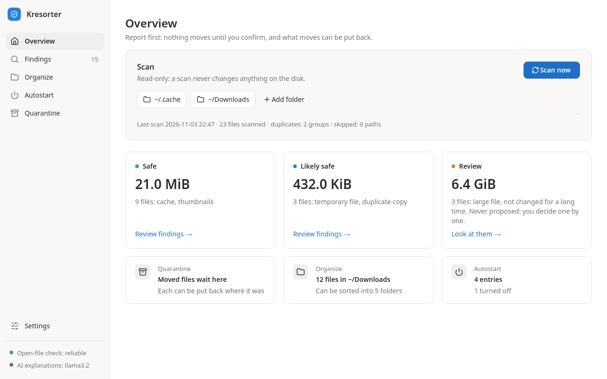
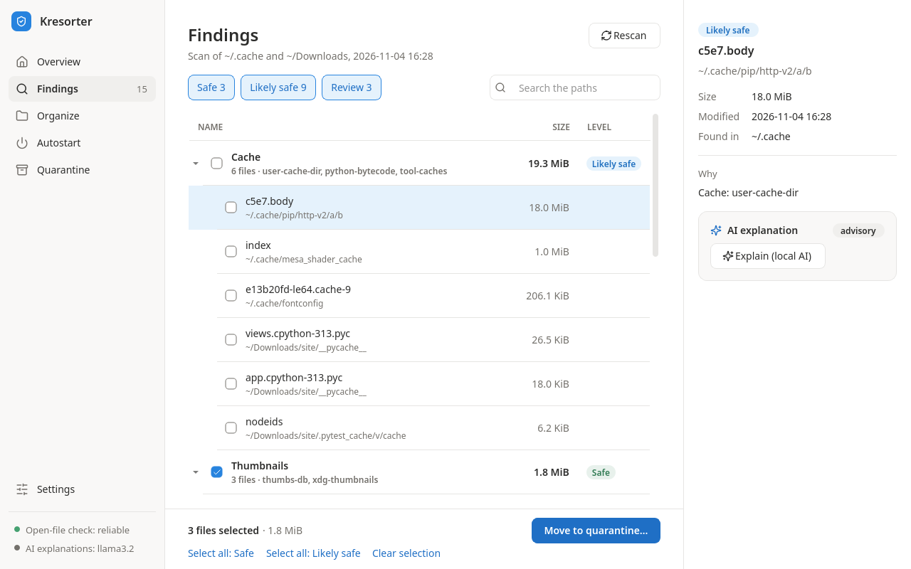
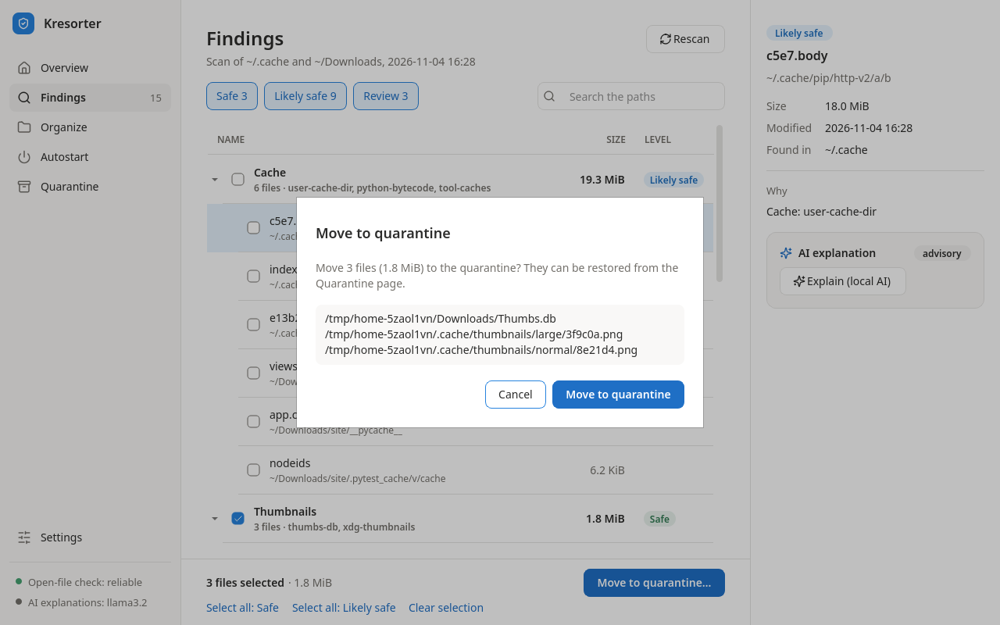
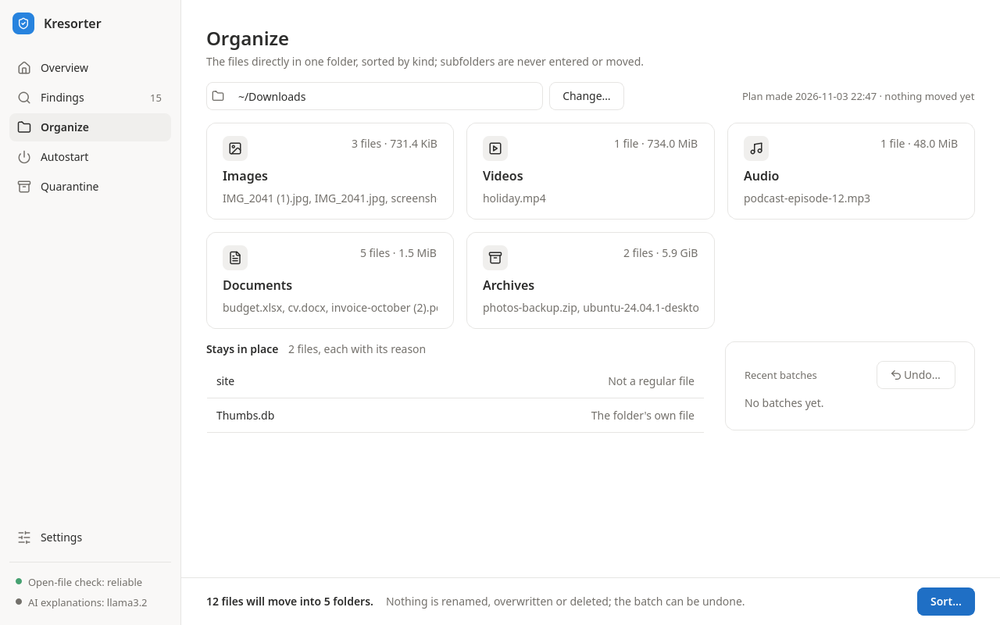
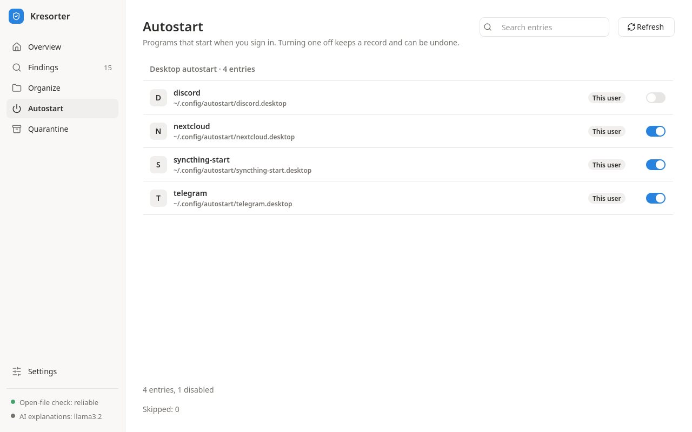
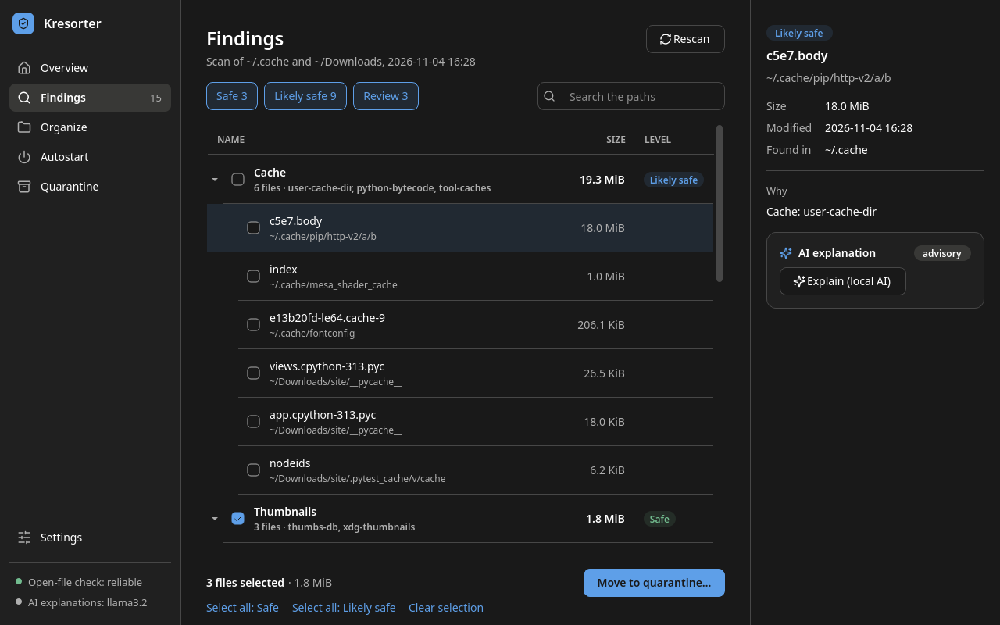

# Kresorter

[English](README.md) | **Русский**

Кроссплатформенное приложение для **безопасной** очистки и разбора файлов на вашем компьютере.
Открытый исходный код, работает только локально, без телеметрии.

> Состояние: альфа-версия, для Windows и Linux: окно и консольные команды. Подробнее — в разделе
> [«Что умеет каждая система»](#что-умеет-каждая-система) и в [плане развития](docs/roadmap.md).



## Принципы безопасности

- **Сначала отчёт.** Ничего не удаляется автоматически: полный отчёт → карантин → удаление только после подтверждения.
- **Всё обратимо.** Каждое действие записывается в журнал до того, как выполняется, и его можно откатить.
- **Никакого прямого удаления.** Всё удаление идёт через API карантина; `os.remove`, `shutil.rmtree`
  и им подобные запрещены и в коде, *и* в тестах (это проверяют ruff и отдельный тест).
- **Безопасные зоны по умолчанию.** Program Files, профили пользователей и открытые файлы — в чёрном списке.
- **Только локально.** Никакой телеметрии; необязательные объяснения ИИ даёт Ollama на вашем
  собственном компьютере, только через loopback, и они только показываются.

## Установка

### Windows

Со страницы [выпусков](https://github.com/KKrecker/kresorter/releases) скачайте один из файлов:

- `Kresorter-<version>-setup.exe`, установщик: только для вас, без прав администратора,
  в `%LOCALAPPDATA%\Programs\Kresorter`, с ярлыком в меню «Пуск» (и на рабочем столе, если
  попросите) и записью в «Параметры → Приложения»;
- `Kresorter-<version>-portable.zip`, та же программа в виде папки: распакуйте её куда угодно и
  запустите `Kresorter.exe` из неё.

Оба варианта — это окно, и оба хранят свои данные в `%LOCALAPPDATA%\kresorter`. Консольные
команды ставятся через pipx, как в Linux: `pipx install kresorter`, с Python 3.11 или новее.

Установщик и `Kresorter.exe` пока не подписаны, поэтому в первый раз SmartScreen их останавливает
(«Система Windows защитила ваш компьютер»): выберите **Подробнее**, затем **Выполнить в любом
случае**. Перед этим сверьте скачанное с `SHA256SUMS.txt` того же выпуска, где по строке на файл:
хеш, который PowerShell печатает заглавными буквами, должен совпасть с тем, что в строке вашего файла.

```powershell
Get-FileHash .\Kresorter-<version>-setup.exe -Algorithm SHA256
```

### Linux

Через [pipx](https://pipx.pypa.io), с Python 3.11 или новее:

```bash
pipx install "kresorter[ui]"   # the window, kresorter-ui, and the commands
pipx install kresorter         # or the commands only
```

Окну нужны несколько системных библиотек Qt; их называет раздел
[Приложение с окном](#приложение-с-окном-по-желанию).

### Что умеет каждая система

| | Windows | Linux | macOS |
| --- | --- | --- | --- |
| Сканирование и анализ | да | да | да |
| Карантин | да | да | нет: отказ |
| Сортировка | да | да | нет: отказ |
| Автозагрузка: список | да | да | да |
| Автозагрузка: отключить, включить | значения Run в `HKCU` | записи XDG | нет: только список |
| Восстановление | да | да | да |
| Объяснения ИИ | да | да | да |
| Окно | установщик, zip или pipx | через pipx | через pipx, не проверено |

Для macOS нет ни сборки, ни CI: её столбец — это то, что код делает там, но на Mac это не
опробовано. Карантин и сортировка там отказываются работать (код выхода 3), потому что для macOS
ещё нет проверки открытых файлов.

Установку проверяет самотест, который CI запускает при каждой сборке:
`Kresorter.exe --self-test report.txt` в папке программы в Windows или
`kresorter-ui --self-test report.txt` при установке через pipx. Он открывает окно, показывает каждую
страницу и закрывает окно, ничего не меняя, затем записывает в `report.txt` по строке на страницу
(`overview: shown` и так далее) и завершается с кодом 0; если что-то не удалось, в отчёте будет
ошибка, а код выхода — 1. Как удалить Kresorter, сказано в разделе
[Удаление программы](#удаление-программы).

## Использование (консоль)

### Отчёты: `scan`, `analyze`

```bash
kresorter scan                 # default safe zones: ~/.cache and ~/Downloads
kresorter scan ~/Projects /tmp # explicit roots (Temp only when chosen explicitly)
kresorter scan --json --no-hash ~/Downloads
kresorter analyze              # a safety level and the reasons for each finding
kresorter analyze --json --large 1024 --older-than 365 ~/Downloads
```

Ни одна из них не меняет диск, даже папку данных kresorter. `scan` перечисляет кандидатов в
мусор, группы дубликатов и всё, что пропустил, с причиной. `analyze` присваивает каждой находке
уровень `safe`, `likely_safe` или `review` и объясняет почему; какая копия из группы дубликатов
остаётся, решается за вас, и эта копия никогда не предлагается. Большие (`--large`, МиБ) и старые
(`--older-than`, дней без изменений) файлы перечисляются только для проверки.

Кэш — это `likely_safe`: он предлагается, но никогда не выбирается за вас, ведь программе, которая
его создала, придётся создавать его заново; миниатюры и служебные файлы папок, которые ведут
системы, остаются `safe`. Но кэш браузера — это `review` (Chrome, Chromium, Firefox, Edge, Brave,
Opera, Vivaldi, Yandex), и он никогда не предлагается: браузеры говорят, что входов в учётные
записи в нём нет, они хранятся в cookie, вне кэша, однако создание кэша заново стоит времени и
трафика каждой страницы, поэтому выбор за вами
([решение 0018](docs/decisions/0018-owners-requests.md)).

### Карантин

```bash
kresorter quarantine add ~/Downloads/old.iso   # move aside (reversible)
kresorter quarantine add --from-analysis --level safe        # show what would move
kresorter quarantine add --from-analysis --level safe --yes  # move it
kresorter quarantine list                      # ids, original paths, sizes
kresorter quarantine restore 3                 # put back; never overwrites
kresorter quarantine purge 3                   # show what would be deleted; deletes nothing
kresorter quarantine purge --yes 3             # permanently delete the vault copy
```

Каждый файл проверяется ещё раз прямо перед перемещением. `--from-analysis` берёт находки `safe`
или, с `--level likely_safe`, `safe` и `likely_safe`; `review` никогда не перемещается скопом.
Карантину нужна надёжная проверка открытых файлов: в Linux и Windows она есть; в macOS эти
команды отказываются работать (код выхода 3), пока для неё нет своей реализации. В Windows
проверка — это монопольное открытие файла, которое тут же закрывается, поэтому она видит каждую
программу, которая читает, пишет или удаляет файл, но не ту, что держит его открытым только ради
атрибутов, и не файл, отображённый в память после того, как его дескриптор закрыт.

### Автозагрузка

```bash
kresorter autostart list                      # every entry with its id; report only
kresorter autostart list --json --include-machine  # Windows: also HKLM, services, tasks
kresorter autostart disable 3f2a9c0d1b7e      # show what would be written
kresorter autostart disable 3f2a9c0d1b7e --yes
kresorter autostart enable 81d4e0a6c2f9 --yes # the id from a new 'list'
```

`list` показывает идентификатор каждой записи; достаточно любого его уникального начала, а у
записи, изменившейся после показа списка, он другой. Изменять можно два источника: записи
автозапуска XDG в Linux и значения Run в `HKCU` в Windows; все остальные источники только
перечисляются и никогда не записываются. Ничего никогда не удаляется: ваша собственная запись
заменяется копией с `Hidden=true`, а оригинал сохраняется; системная запись перекрывается
заглушкой в вашей папке автозапуска, в `/etc` ничего не пишется; значение Run получает флаг
`StartupApproved`, который ставит Диспетчер задач, а само значение не трогается. `enable`
возвращает только то, что изменил kresorter.

### Сортировка

```bash
kresorter organize move ~/Downloads        # show the plan; changes nothing
kresorter organize move ~/Downloads --yes  # sort it: ~/Downloads/<Category>/<name>
kresorter organize list                    # batches, newest first
kresorter organize undo 4                  # show what would move back
kresorter organize undo 4 --yes            # move it back
```

Перемещаются только обычные файлы, лежащие прямо в папке, каждый в `<folder>/<Category>/<its name>`
(`Images`, `Videos`, `Audio`, `Documents`, `Archives`, `Installers`); в подпапки команда никогда не
заходит и не перемещает их. Ничего не переименовывается, не перезаписывается и не удаляется:
файл, место назначения которого занято, остаётся, а отмена оставляет папки категорий. Папка,
файлы которой ломаются от перемещения, отклоняется целиком (домашняя папка или выше неё,
библиотека игр, проект, папка кэша или временных файлов), а каждый остающийся файл перечисляется
с причиной: ссылки, служебные файлы самой папки, незавершённые загрузки, мусор, неизвестные типы
(включая веб-страницы), файлы со спутниками (`movie.mkv` и `movie.srt`), программы рядом со своими
библиотеками. Каждый файл проверяется ещё раз прямо перед перемещением; пакет, который
останавливается, возвращает то, что успел переместить. В Windows папка, которую ведёт клиент
синхронизации (OneDrive, Dropbox, iCloud и любой другой клиент, известный Windows), отклоняется
целиком, поскольку перемещение там доходит до каждого устройства, а файл, новый путь которого
был бы длиннее 259 символов, остаётся на месте. Сортировка перемещает файлы в Linux и Windows, с
их проверками открытых файлов: в macOS и везде, где проверке открытых файлов нельзя доверять,
`move` и `undo` отказываются работать (код выхода 3) и называют, что им мешает, а `list` и
`recover` работают.

### Восстановление

```bash
kresorter recover   # close interrupted work of every kind; `autostart recover` is the same
```

Команды, которые действуют (`quarantine`, `organize`, `autostart disable|enable`, `recover`), ведут
один журнал в одной папке данных, и одновременно работает только одна из них. Папка данных —
это `$XDG_DATA_HOME/kresorter` (по умолчанию `~/.local/share/kresorter`) в Linux,
`~/Library/Application Support/kresorter` в macOS и `%LOCALAPPDATA%\kresorter` в Windows;
kresorter отказывается использовать папку внутри зоны сканирования. Каждая команда сначала
завершает свою прерванную работу; если осталась работа другого вида, она ничего не меняет и
называет `kresorter recover`. Восстановление решает по тому, что есть на диске или в реестре,
ничего не переделывая и не отменяя. Команде `kresorter recover` не нужна проверка открытых
файлов, поэтому она работает и там, где карантин и сортировка действовать не могут; она называет
файлы, которые прерванный пакет сортировки оставил разложенными, и `organize undo`, который
вернёт их обратно.

### Объяснения ИИ (по желанию)

```bash
kresorter llm status                           # what is in place, and how to set up the rest
kresorter analyze --explain                    # the report, then what its findings are
kresorter autostart list --json --explain      # four keys added to the JSON
kresorter organize move ~/Downloads --explain  # the plan, then why files stay; not with --yes
```

`--explain` добавляет объяснения простым языком к тому, что kresorter уже решил: что такое кэш
или тип файла, что делает программа из автозагрузки, почему файл остаётся. Их пишет языковая
модель, работающая в [Ollama](https://ollama.com) на вашем компьютере; это лишь советы, и они
могут быть неверными. Уровни, планы, отказы, собственный вывод команды и код выхода — те же, что
и у запуска без `--explain`; ответ только показывается, он никогда не выполняется и ни на что не
влияет, и ничего не сохраняется. Ни одна команда не обращается к Ollama без `--explain` или
`llm status`, а без Ollama всё работает как обычно: запуск, не получивший объяснения, печатает в
stderr одну строку с причиной. За один запуск задаётся вопрос не более чем о 20 темах, по одному
запросу на тему, а результаты с одинаковыми фактами — одна тема (тысяча файлов `__pycache__` —
один вопрос). С `--json` в отчёте появляются `explanations`, `explanations_model`,
`explanations_not_explained` и `explanations_unavailable`.

Ollama и модель устанавливаете вы, а не kresorter: kresorter не запускает никаких программ,
поэтому не устанавливает, не обновляет, не запускает и не настраивает их. `kresorter llm status`
сообщает, что нашёл и что осталось сделать (код выхода 0, когда всё на месте, иначе 1):

```text
Ollama: not reachable at http://127.0.0.1:11434 ([Errno 111] Connection refused)
Model: llama3.2: not checked
AI explanations: unavailable; kresorter works as usual without them
To set them up (kresorter installs nothing itself):
  1. Install Ollama from https://ollama.com/download and start it
  2. Download the model: ollama pull llama3.2
  3. Check again: kresorter llm status
Settings: KRESORTER_LLM_SERVER (ollama or lmstudio, default ollama),
  KRESORTER_OLLAMA_URL (a loopback address, default http://127.0.0.1:11434),
  KRESORTER_OLLAMA_MODEL (default llama3.2)
```

Обе настройки — переменные окружения. `KRESORTER_OLLAMA_URL`, по умолчанию
`http://127.0.0.1:11434`, имеет вид `http://HOST[:PORT]`, где HOST — это `localhost`, адрес из
`127.0.0.0/8` или `[::1]` (для Ollama, которая слушает только `::1`, нужен `http://[::1]:11434`);
всё остальное отклоняется, настройки прокси не учитываются, а перенаправления не выполняются.
`KRESORTER_OLLAMA_MODEL`, по умолчанию `llama3.2`, называет модель, которую вы скачали. В окне
модель можно выбрать на странице «Настройки» среди тех, что есть у Ollama (смотрите
[Приложение с окном](#приложение-с-окном-по-желанию)); команды используют только
`KRESORTER_OLLAMA_MODEL`.

Каждое объяснение посвящено одной теме, и отправляются только её факты; объяснение подписано ими в
виде `name=value`:

- `finding` (`analyze`): `level`, `reasons` (причина «мусор» вместе с её правилом, как в
  `junk_cache:python-bytecode`), `extension` (суффикс имени файла в нижнем регистре, `.pdf`)
- `autostart` (`autostart list`): `source`, `scope`, `name`, `program` (имя файла программы,
  которую запускает команда записи: `app` для `/usr/bin/app --tray`), `enabled`
- `stay` (файл, который `organize move` оставляет на месте): `reason`, `extension`

Больше ничего не отправляется: ни путь, ни папка, ни размер, ни время, ни хеш, ни расположение,
ни команда целиком, ни примечания и подробности, и никогда — содержимое файла.

### Коды выхода

| Код | Значение |
|---|---|
| 0 | готово; отчёты всегда завершаются с 0 |
| 1 | что-то было отклонено, откачено или не подтверждено (предпросмотр), или делать было нечего |
| 2 | ошибка в вызове команды |
| 3 | здесь нельзя действовать безопасно: нет надёжной проверки открытых файлов (или, для сортировки, другого препятствия со стороны системы), есть незавершённая работа другого вида, папка данных, блокировка или журнал, которыми нельзя пользоваться, изменение не удалось или его нельзя проверить, или пакет перемещений остановился |

`scan`, `analyze` и `autostart list` завершаются с 0 или 2, с `--explain` или без него;
`llm status` — с 0, 1 или 2; `recover` и `organize list` — с 0, 2 или 3. Для `organize` файлы,
которые остаются по плану, — не отказы.

## Приложение с окном (по желанию)

Окно — это дополнение: консольным командам оно совсем не нужно. В Windows это установщик или
переносимый zip (смотрите [Установка](#установка)); с pip или pipx это дополнение `ui`:

```bash
pip install "kresorter[ui]"   # adds PySide6-Essentials
kresorter-ui
python -m kresorter.ui        # the same window
```

В Linux для Qt нужны несколько системных библиотек; в Debian или Ubuntu:

```bash
sudo apt-get install libegl1 libgl1 libxkbcommon0 libfontconfig1 libdbus-1-3
```

Без PySide6 `kresorter-ui` говорит, какое дополнение установить, и завершается с кодом 3; когда
Qt не может загрузить одну из этих библиотек, он называет ошибку и библиотеки и тоже завершается
с кодом 3.

Боковая панель открывает шесть страниц, а под ними показаны проверка открытых файлов и модель
локального ИИ:

- **Обзор**: папки для сканирования (безопасные зоны и папки, которые добавили вы) и
  «Сканировать», которое только читает, а пока идёт работа, показывает бегущую полосу и число уже
  прочитанных файлов. Безопасную зону можно исключить её кнопкой удаления и вернуть её собственной
  ссылкой (`+ ~/.cache`); окно это запоминает. Затем идут карточка на каждый уровень с его
  файлами, размером и самыми весомыми причинами, которая открывает «Находки» только с этим
  уровнем, и по карточке для карантина, сортировки, автозагрузки и локального ИИ: используемая
  модель и нашла ли её последняя проверка доступной; эта карточка открывает «Настройки».
- **Находки**: сгруппированы по самой весомой причине, с переключателем для каждого уровня и
  поиском, а справа — подробности о выбранном файле и о том, почему он найден. Сначала выбрано
  только то, что предлагается на уровне «Безопасно»; находку уровня «Проверить» выбирает только её
  собственный флажок, а копию, которую оставляет группа дубликатов, — ничто. «Переместить в
  карантин» на панели внизу перемещает выбранное.
- **Сортировка**: план для папки — карточка на каждую категорию и файлы, которые остаются, с их
  причинами; «Разложить» перемещает план одним пакетом, а недавние пакеты можно отменить. Там, где
  `organize` отказывается работать (macOS или нет надёжной проверки открытых файлов), страница
  говорит почему. Окно на русском называет категории по-русски, но папки сохраняют английские
  имена (`Images`, `Documents`, ...) на любом языке, поэтому `organize undo` возвращает то, что
  разложило окно, а окно — то, что разложила команда. Когда план показан, «Сгруппировать по
  смыслу (локальный ИИ)» просит локальную модель сгруппировать файлы по тому, о чём говорят их
  имена (поездка, налоги): отправляются только имена файлов, которые план перемещает или
  оставляет из-за неизвестного типа, отсортированные, не более 100 имён не длиннее 100 символов
  каждое, без пути, папки, размера, времени и содержимого. Группы из ответа, не более 12, по два
  файла или больше, в папки с допустимыми именами, составляют новый план через тот же
  планировщик, который проверяется как любой другой; страница говорит, что группы получены от
  локального ИИ и могут быть неверными, а «По типу» возвращает прежний план. Затем «Разложить»
  перемещает показанный план, не спрашивая модель снова, одним пакетом, который можно отменить.
- **Автозагрузка**: записи по источникам, у каждой — расположение, область действия и
  переключатель, включённый, пока она запускается, и поиск по именам и расположениям;
  переключатель записи, которую можно изменить, отключает или включает её, а у записи, которую
  изменить нельзя, — замок.
- **Карантин**: файлы в карантине, с кнопками «Выбрать все» и «Снять выбор»; «Восстановить» или
  «Удалить навсегда», единственная красная кнопка, действуют на отмеченные файлы.
- **Настройки**: по карточке на язык (когда новый язык сохранён, «Перезапустить сейчас» снова
  открывает окно на нём, на той же странице), оформление («Как в системе», «Светлая» или
  «Тёмная»), которое применяется сразу, в Windows — общесистемные записи автозагрузки (выключены,
  пока вы их не включите), локальный ИИ с его проверкой и папку данных. Проверка показывает
  модели, которые есть у Ollama, чтобы выбрать ту, которой пользуются все объяснения и
  группировки; `KRESORTER_OLLAMA_MODEL`, если она задана, важнее, и карточка об этом говорит.
  Карточка рекомендует модель по памяти и процессорам компьютера, Qwen 2.5 — из-за её русского:
  `qwen2.5:1.5b` при памяти меньше 8 ГиБ, `qwen2.5:3b` — меньше 16 ГиБ, `qwen2.5:7b` — меньше
  32 ГиБ, `qwen2.5:14b` — в остальных случаях, и на размер меньше, если процессоров меньше
  четырёх; её получают командой `ollama pull` с именем модели, kresorter ничего не устанавливает.









Окно следует светлой или тёмной схеме системы или той, что выбрана в оформлении; его значки —
от [Lucide](https://lucide.dev), они поставляются вместе с ним по лицензии ISC. Окну нужен экран
шириной не меньше 1056 px на английском и 1183 px на русском — ради панели «Находок» и
подробностей рядом с ней (экран 1366 x 768 при масштабе 125 % имеет ширину 1093 px).



Ничего не меняется, пока вы не подтвердите: каждое действие (карантин, восстановление, удаление
навсегда, сортировка, отмена, отключение, включение, восстановление после сбоя) сначала открывает
диалог, который показывает, что будет сделано, с «Отменой» как кнопкой по умолчанию. Окно
выполняет то же, что и команды, с тем же журналом и той же блокировкой: что переместило одно,
другое может восстановить или отменить, а найдя прерванную работу, окно предлагает
«Восстановить после сбоя», как это делает `kresorter recover`. «Объяснить (локальный ИИ)» под
находкой, записью автозагрузки или файлом, который остаётся на месте, спрашивает Ollama только об
этом одном результате и только когда вы нажимаете эту кнопку (смотрите
[Объяснения ИИ](#объяснения-ии-по-желанию)).

Окно говорит по-английски или по-русски: по умолчанию на языке системы (по-русски, когда он
русский, иначе по-английски) или на языке, выбранном на странице «Настройки», — сразу, через
«Перезапустить сейчас», или со следующего открытия. Оно хранит один файл, `settings.json` в папке
данных (смотрите [Восстановление](#восстановление)), по умолчанию
`{"language": "system", "include_machine": false, "skipped_zones": [], "theme": "system"}`,
а когда модель выбрана, то и с `model`; он записывается, только когда вы меняете настройку, а
испорченный файл, файл больше 64 КиБ или ссылка на его месте не используются, о чём говорит
страница «Настройки». Никакие находки, пути, планы, группы или объяснения не сохраняются.

## Удаление программы

Удаление убирает программу Kresorter и никогда не трогает её данные. Папка данных
(`%LOCALAPPDATA%\kresorter` в Windows, `~/.local/share/kresorter` в Linux) хранит журнал,
хранилище с файлами в карантине, хранилище автозагрузки и `settings.json`. Файлы, которые ещё
лежат в карантине, тоже остаются там: посмотрите их командой `kresorter quarantine list` или на
странице «Карантин» и сначала восстановите или удалите их. Удалить папку данных после этого — ваш
собственный шаг.

- **Windows, установленная программа**: «Параметры → Приложения → Kresorter → Удалить». Это
  удаляет то, что установщик положил в `%LOCALAPPDATA%\Programs\Kresorter`, и ярлыки.
- **Windows, переносимая версия**: удалите распакованную вами папку `Kresorter`; рядом с собой
  она ничего не записывала.
- **pipx или pip**: `pipx uninstall kresorter` или `pip uninstall kresorter` в том окружении, в
  которое вы её установили.

## Разработка

```bash
python -m venv .venv && . .venv/bin/activate
pip install -e ".[dev]"
ruff check . && ruff format --check . && mypy && pytest
```

Python от 3.11 до 3.14. `pytest` проваливается, если покрытие строк и ветвей ниже 100 %, и при
любом предупреждении. Снимки экрана в [`docs/screenshots/`](docs/screenshots/) не нарисованы, а
сняты: это окно без экрана (offscreen), на вымышленной домашней папке, на английском, их делает
`PYTHONPATH=tests python -m support.screenshots` (один экран или все шесть, если ни один не назван).

Решения записаны в [`docs/decisions/`](docs/decisions/); план — в [`docs/roadmap.md`](docs/roadmap.md).

Выпуск — это тег `vX.Y.Z`, который отправляет владелец после того, как запуски на чистых машинах
записаны в `docs/releases/X.Y.Z.md` ([форма](docs/releases/README.md)): задание release проверяет
тег, журнал изменений и эту запись, прежде чем что-либо опубликовать.

## Лицензия

Kresorter распространяется по лицензии MIT, правообладатель — KKrecker: [`LICENSE`](LICENSE).
Значки окна — от Lucide, по лицензии ISC:
[`src/kresorter/ui/icons/LICENSE`](src/kresorter/ui/icons/LICENSE). Оба файла есть и в wheel, и
в sdist.

Сборка для Windows (установщик и переносимый zip) содержит Python по лицензии PSF, а также Qt и
PySide6 по LGPL-3.0, отдельными файлами, которые можно заменить: `THIRD-PARTY-NOTICES.txt` рядом с
`Kresorter.exe` называет каждую часть, её лицензию и то, где взять её исходный код, а в папке
`licenses` лежат их тексты. Установщик показывает `LICENSE` перед установкой, а страница
«Настройки» указывает лицензию под номером версии.
